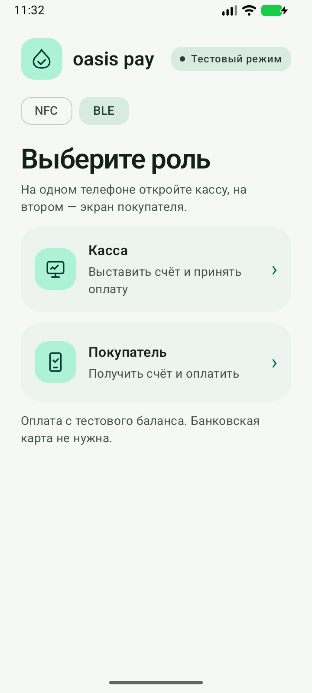
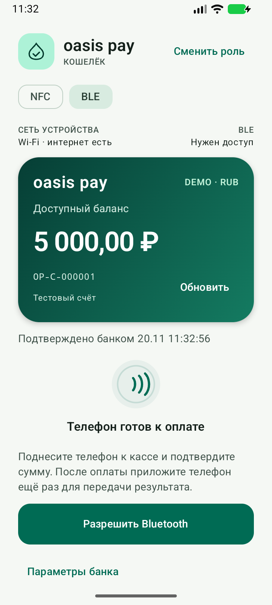
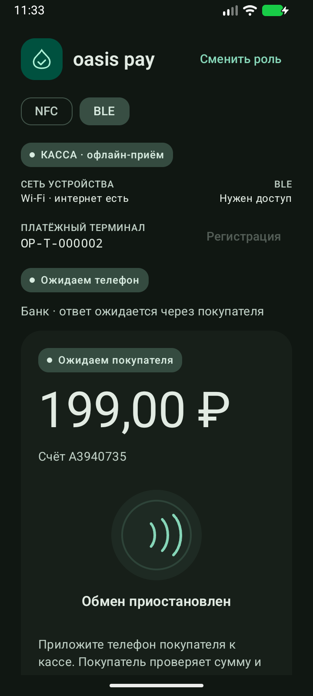

# Oasis Pay

**Демонстрационная офлайн-касса и тестовый кошелёк для Android.** В одном приложении можно выбрать NFC или BLE. Касса выставляет подписанный счёт, покупатель подтверждает сумму и обращается в тестовый банк по HTTPS. Затем телефон возвращает подписанный ответ на кассу. После регистрации касса может работать без сети.

[Скачать подписанный APK 1.4](oasis-pay.apk) · [Подключить банк без USB](docs/HOTSPOT_SETUP.md) · [Банк на Android](docs/ANDROID_BANK.md) · [Протокол](docs/PROTOCOL.md)

  
  
  

| Режим | Устройства | Как начать обмен |
| --- | --- | --- |
| **NFC** | Два Android-устройства с NFC. Кассе нужна эмуляция карты HCE | Совместите NFC-антенны на задних панелях |
| **BLE** | Два Android-устройства с Bluetooth LE. Кассе нужна BLE-реклама | Разрешите Bluetooth, приложите устройства друг к другу и дождитесь счёта |

В BLE касса объявляет себя на минимальной мощности. Покупатель ждёт минимум три свежих измерения сигнала от одной кассы не слабее −45 dBm и проверяет близость повторно перед доставкой ответа. Это экспериментальный порог. Рабочая дистанция зависит от антенн, ориентации, чехлов и окружения. Для сценария с физическим касанием используйте NFC, типичная дальность которого по данным NFC Forum составляет до 2 см. [NFC Forum](https://nfc-forum.org/learn/NFC-technology/) · [Bluetooth SIG о RSSI](https://www.bluetooth.com/blog/proximity-and-rssi/)

## Запуск за три шага

1. Запустите Docker Desktop и выполните `./oasis network` из корня репозитория. Для Mac и устройств Android используйте личную Wi-Fi-сеть, где разрешён обмен между клиентами. Банк выведет адрес, отпечаток TLS и коды ролей.
2. Установите APK на оба устройства с Android 13+. Выберите **один и тот же транспорт** и разные роли. На экране подключения вставьте настройки из `./oasis show`, нажмите **Проверить связь с банком**, затем **Подключить**.
3. На кассе введите сумму и начните приём. Приложите телефон покупателя, проверьте счёт и подтвердите оплату блокировкой экрана. Приложите телефон ещё раз и дождитесь подтверждения кассы. Для сверки используйте `./oasis ledger`.

Если телефон видит Wi-Fi, но банк недоступен, проверьте [маршрут, порт, TLS и дату](docs/HOTSPOT_SETUP.md). Для Android и Mac в разных сетях там же описан запуск в частной сети Tailscale.

## Сборка и тесты

`./build-android` запускает тесты Android и выпускает подписанный APK. Для установки поверх прежнего приложения нужен тот же ключ подписи. `./oasis test` проверяет банк в отдельной схеме PostgreSQL. [Команды банка](docs/BANK_COMMANDS.md).

Снимки сделаны на Android-эмуляторе с отдельным тестовым банком. Регистрация обеих ролей и получение баланса проверены с Android по сетевому адресу Mac без перенаправления портов. Расстояние BLE и полный NFC-обмен проверяются на физических устройствах.
